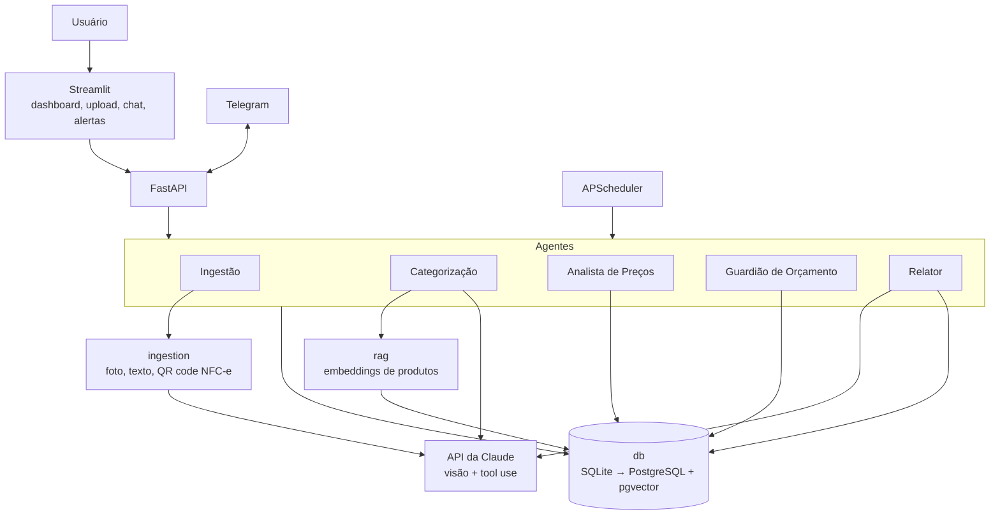

# 01. Arquitetura

Visão da arquitetura-alvo. Nem tudo existe desde a Fase 1; a coluna "Fase" indica quando cada parte entra.

## Diagrama

Fluxo principal de ingestão: **foto/texto → extração (JSON) → revisão humana na UI → gravação no banco → categorização → análises**. A gravação só acontece depois da confirmação.

## Componentes e responsabilidades

| Componente | Local | Responsabilidade | Fase |
|---|---|---|---|
| **Interface** | `app/` | Dashboard, upload com revisão antes de salvar, chat, central de alertas. Não contém regra de negócio; chama a API. | 1 |
| **API** | `src/homewise/api` | Expõe os casos de uso por HTTP (FastAPI). Valida entrada e orquestra. | 1 |
| **Ingestão** | `src/homewise/ingestion` | Transforma foto, texto ou QR code de NFC-e em JSON estruturado e validado (pydantic). Não grava no banco. | 1 |
| **Banco de dados** | `src/homewise/db` | Esquema, acesso e consultas. Única fonte de números. Guarda compras, itens, produtos, categorias e histórico de preços. | 1 |
| **RAG** | `src/homewise/rag` | Busca por similaridade (embeddings) para normalizar produtos, consultar a base de conhecimento e a memória do lar. | 2 |
| **Agentes** | `src/homewise/agents` | Ver abaixo. Cada um tem uma responsabilidade e usa tools; os números vêm das tools (SQL/código). | 1–5 |
| **Configuração** | `src/homewise/config.py` | Lê variáveis de ambiente (`.env`) em um único lugar. | 1 |
| **Agendador** | APScheduler | Dispara rotinas (pareceres diário, semanal, mensal; verificações de preço). | 4 |
| **Notificações** | Telegram | Envia alertas e relatórios. | 4 |
| **Evals** | `evals/` | Notas reais com gabarito para medir a qualidade da extração e da categorização. As notas reais ficam fora do Git. | 1 em diante |

## Agentes

| Agente | Responsabilidade | O que NÃO faz |
|---|---|---|
| **Ingestão** | Extrai itens, quantidades, preços, data e loja de uma nota ou texto. Devolve JSON para revisão. | Não grava sem confirmação. |
| **Categorização** | Normaliza o nome do produto e atribui a categoria, usando RAG sobre produtos já conhecidos. | Não inventa categoria fora da lista. |
| **Analista de Preços** | Interpreta e explica os aumentos de preço e anomalias detectados pelo código. | Não calcula a variação; recebe pronta do código. |
| **Guardião de Orçamento** | Acompanha o gasto por categoria contra o orçamento e explica os alertas. | Não soma valores; usa SQL. |
| **Relator** | Escreve os pareceres diário, semanal e mensal com os números já calculados. | Não faz conta nem cita número que não veio de uma tool. |

## Divisão entre código e LLM

| Código/SQL (determinístico) | LLM (interpretação) |
|---|---|
| Somas, médias, variação de preço | Ler a foto e extrair itens |
| Detecção de aumento e anomalia (estatística simples) | Sugerir a categoria de um produto |
| Comparação com orçamento | Explicar um alerta em linguagem natural |
| Validação dos dados extraídos | Redigir o parecer |

## Dados e segurança

- Dados financeiros ficam em `data/` e `*.db`, fora do Git.
- Chaves ficam em `.env`, fora do Git.
- Notas reais de teste ficam em `evals/notas_reais/`, fora do Git.
- Foto de nota fiscal vai para a API da Claude ao ser processada. Evitar dados pessoais desnecessários (CPF na nota, por exemplo) quando possível.

## Evolução prevista

- **Fase 1:** SQLite, sem RAG, sem agentes agendados.
- **Fase 2:** PostgreSQL + pgvector. A camada `db` isola essa troca (ver [ADR 0001](adr/0001-stack-inicial.md)).
- **Fases 3–5:** orçamentos, alertas, agendamento, Telegram e chat com tool use.

Um documento `02-modelo-de-dados.md` será criado quando desenharmos o esquema do banco, por isso a numeração pula o 02.
